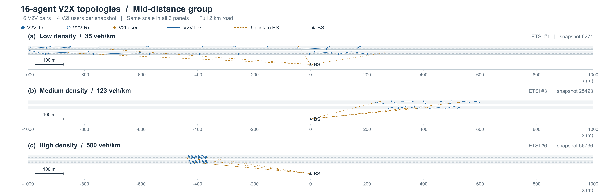

# V2X-MARL-Bench

<p align="center">
  <a href="https://arxiv.org/abs/2603.06607"></a>
  <a href="https://doi.org/10.1109/ICC52391.2025.11161818"></a>
  
  
  <a href="LICENSE"></a>
</p>

**A benchmark for multi-agent reinforcement learning (MARL) in C-V2X sidelink radio resource allocation.**

Vehicle-to-vehicle (V2V) links share the uplink spectrum of vehicle-to-infrastructure (V2I) users. Each V2V
transmitter is an agent that picks a subchannel and a transmit power at every step, so that its periodic safety
messages arrive in time without degrading the V2I links. V2X-MARL-Bench turns this problem into four tasks that add
one MARL challenge at a time, evaluates eight standard MARL algorithms on them under one protocol, and releases the
code, the vehicle-position datasets and the evaluation sets.

## News

- **2026-10** — Updated evaluation sets, Table V presets and checkpoint support.

See the [changelog](CHANGELOG.md) for update details and corrections affecting older results.

## Contents

- [Benchmark at a Glance](#benchmark-at-a-glance)
- [Installation](#installation)
- [Quick Start](#quick-start)
- [Reproducing the Paper](#reproducing-the-paper)
- [Command-Line Reference](#command-line-reference)
- [Outputs](#outputs)
- [Repository Structure](#repository-structure)
- [Citation](#citation)

## Benchmark at a Glance

### System model

| | |
|---|---|
| Road | 2 km highway, 3 lanes per direction, vehicle positions from SUMO |
| Traffic | Datasets from [SUMO-V2X-MARL-Bench](https://github.com/Deepinlab2023/SUMO-V2X-MARL-Bench/tree/main), covering ETSI highway scenarios #1–#6 (35–500 veh/km; nominal speeds 50–250 km/h) |
| Channel | 3GPP TR 36.885: pathloss, shadowing, fast fading (on by default), 2 GHz carrier |
| Base&nbsp;station | at x = 0, 35 m from the road, 25 m antenna height |
| Agents | 4, 8 or 16 V2V pairs; 4 V2I users |
| Action&nbsp;per&nbsp;agent | one of 4 subchannels (1 MHz each) × power {23, 10, 5} dBm, or no transmission |
| Payload&nbsp;per&nbsp;agent | 6 CAMs of 1060 bytes, to be delivered within one episode (50 steps of 1 ms) |
| Reward | shared by all agents: V2V payload delivery plus a V2I rate term (NFIG: weighted V2V and V2I spectral efficiency) |

### Tasks

Each task adds one challenge to the previous one.

| Task | Steps | Observation | Topology | Added challenge |
|------|-------|-------------|----------|-----------------|
| NFIG | 1 | Full | Fixed | Coordination, non-stationarity |
| SIG&nbsp;SL | 50 | Full | Fixed | Sequential decisions, fast fading |
| SIG&nbsp;ML | 50 | Full | Resampled | Topology generalization |
| POSIG | 50 | Local | Resampled | Partial observability |

SIG ML and POSIG sample a new topology each episode.

NFIG is a one-shot normal-form game without fading; SIG is a stochastic game; POSIG is its partially observable
version, where each agent only sees its own channel gains, the interference it received and its remaining payload.

### Algorithms

| | Independent learning (IL) | Centralized training, decentralized execution (CTDE) |
|---|---|---|
| **Value-based** | IDQN (`idql`), Hysteretic IDQN (`hys`) | VDN (`vdn`), QMIX (`qmix`) |
| **Actor-critic** | IA2C (`ia2c`), IPPO (`ippo`) | MAA2C (`maa2c`), MAPPO (`mappo`) |

### Data and evaluation sets

Vehicle sampling, V2I user selection and V2V pairing are implemented in the dataset generator's
[preprocessing script](https://github.com/Deepinlab2023/SUMO-V2X-MARL-Bench/blob/main/scripts/preprocess.py).

| Set | Files (`Environment/SUMOData/`) | Content |
|-----|----------------------------------|---------|
| Training&nbsp;pool | `SIG_ML_k{4,8,16}.csv` | 30k (4 agents) / 60k (8, 16 agents) topologies from ETSI scenarios #1–#6 |
| UNSEEN-100 | `eval_sets/unseen100_k{n}.csv` | 100 topologies held out of SIG ML / POSIG training |
| SEEN-100 | `eval_sets/seen100_k{n}.csv` | 100 training topologies, stratified like UNSEEN-100 |
| rep9&nbsp;(test&nbsp;set) | `eval_sets/rep9_k{n}.csv` | 9 representative topologies of UNSEEN-100, one per density × BS distance |

<p align="center">
  
</p>

The paper reports all tasks on rep9. `Environment/build_eval_sets.py` rebuilds the evaluation sets;
`eval_sets_meta.csv` lists the scenario, distance band and position of every topology.

## Installation

Requires Python 3.10 or later and [Git LFS](https://git-lfs.com), which stores the datasets.
Runs on CPU; CUDA is used automatically when available.

```bash
git lfs install
git clone https://github.com/Deepinlab2023/V2X-MARL-Bench.git
cd V2X-MARL-Bench
pip install -r requirements.txt
```

If the CSV files in `Environment/SUMOData/` are only a few hundred bytes, they are LFS pointers; run `git lfs pull`.

## Quick Start

```bash
# SIG ML, 4 agents, MAPPO: train on the training pool, evaluate on rep9 at every test point
python main.py --env SIG --algo mappo --seed 9 \
    --eval_sets Environment/SUMOData/eval_sets/rep9_k4.csv

# SIG SL on one rep9 topology (snapshot 1399), IDQN
python main.py --env SIG --algo idql --seed 9 \
    --train_data Environment/SUMOData/eval_sets/rep9_k4.csv --loc 1399 --state_order agent_first

# POSIG, 16 agents, IPPO
python main.py --env POSIG --algo ippo --n_agent 16 --seed 9
```

Each run prints its configuration and saves results under `Results/<ALGO>/`; see [Outputs](#outputs).

## Reproducing the Paper

The task presets in `Configuration/presets/` hold the hyperparameters of Table V, so most runs need no extra
arguments. Table V uses 5 seeds (9, 10, 12, 87, 91) and the rep9 test set.

Before running these commands, apply the VDN SIG ML and 16-agent QMIX SIG SL overrides in the
[Table V reproduction notes](CHANGELOG.md#table-v-reproduction-notes), which also list topology IDs and fading settings.
Run counts are per algorithm and agent count.

| Task | Agents | Runs |
|------|--------|------|
| NFIG | 4 | 9 topologies × 5 seeds |
| SIG&nbsp;SL | 4, 8, 16 | 9 topologies × 5 seeds |
| SIG&nbsp;ML | 4, 8, 16 | 5 seeds |
| POSIG | 4, 8, 16 | 5 seeds |

<details>
<summary>Commands for one seed</summary>

Replace `<algo>`, `<n>`, `<s>` and `<snapshot>` with the chosen algorithm, agent count, seed and topology ID.

```bash
# NFIG (4 agents)
python main.py --env NFIG --algo <algo> --n_agent 4 --seed <s> \
    --train_data Environment/SUMOData/eval_sets/rep9_k4.csv --loc <snapshot>

# SIG SL
python main.py --env SIG --algo <algo> --n_agent <n> --seed <s> \
    --train_data Environment/SUMOData/eval_sets/rep9_k<n>.csv \
    --loc <snapshot> --state_order agent_first

# SIG ML
python main.py --env SIG --algo <algo> --n_agent <n> --seed <s> \
    --state_order agent_first \
    --eval_sets Environment/SUMOData/eval_sets/rep9_k<n>.csv

# POSIG
python main.py --env POSIG --algo <algo> --n_agent <n> --seed <s> \
    --eval_sets Environment/SUMOData/eval_sets/rep9_k<n>.csv
```

</details>

Table V reports the highest seed-averaged return over the 100 test points of training, normalized so that a random
policy scores 0 and a reference allocation scores 1 (exhaustive search for 4 agents, greedy for 8 and 16 agents).

## Command-Line Reference

```bash
python main.py --env <ENV> --algo <ALGO> [options]
```

| Argument | Description |
|----------|-------------|
| `--env` | `NFIG`, `SIG` or `POSIG` |
| `--algo` | `idql`, `hys`, `vdn`, `qmix`, `ia2c`, `maa2c`, `ippo`, `mappo` |
| `--n_agent` | `4` (default), `8` or `16` |
| `--loc` | NFIG and SIG SL: the topology. With `--train_data`, a `snapshot_id` of that file; otherwise an index 0–8 into the legacy test set `NFIG_k<n>.csv`. Omit for SIG ML and POSIG |
| `--seed` | seeds NumPy, Python and PyTorch |
| `--eval_sets` | topology CSVs evaluated at every test point (one episode per topology) |
| `--train_data`, `--test_data` | replace the default training / test CSV |
| `--config` | sparse JSON overriding the preset |

Task presets load automatically; `--config <file.json>` overrides selected hyperparameters.
For the full option list, run `python main.py --help`.

## Outputs

| Output | Location |
|--------|----------|
| Test&nbsp;returns | `Results/<ALGO>/*.csv` |
| Extra&nbsp;evaluation&nbsp;sets | `Results/<ALGO>/*_eval-<set>.csv` |
| Final&nbsp;checkpoints | `Results/<ALGO>/models/*.pt` |

Checkpoints contain the final training weights; the paper reports the best seed-averaged test return during
training. Use the same training configuration when evaluating a checkpoint.

## Repository Structure

```
V2X-MARL-Bench/
├── main.py              # Entry point
├── Configuration/       # Environment constants, algorithm parameters, task presets
├── Environment/         # Channel model, reward, state; SUMO datasets and evaluation sets
├── Runners/             # Experiment orchestration per algorithm family
├── Trainers/            # Training loop of each algorithm
├── Networks/            # Actors, critics and Q-networks
├── Helpers/             # GAE, replay buffers, statistics, plotting
├── Benchmarkers/        # Periodic evaluation on the test topologies and evaluation sets
└── Results/             # Result CSVs and models (created at run time)
```

## Citation

If you find V2X-MARL-Bench useful in your research, we would appreciate a citation:

```bibtex
@misc{wang2026v2xmarlbench,
  title         = {Multi-Agent Reinforcement Learning for {V2X} Resource Allocation: Disentangling {MARL} Challenges Through Benchmarking},
  author        = {Wang, Siyuan and Lei, Lei and Maheshwari, Pranav and Bellefeuille, Sam and Zheng, Kan},
  year          = {2026},
  eprint        = {2603.06607},
  archivePrefix = {arXiv},
  primaryClass  = {cs.MA},
  url           = {https://arxiv.org/abs/2603.06607}
}
```

The benchmark extends our preliminary study at ICC 2025:

```bibtex
@inproceedings{wang2025marl,
  author    = {Wang, Siyuan and Maheshwari, Pranav and Lei, Lei and Mei, Jie and Zheng, Kan},
  title     = {Multi-Agent {DRL} for Resource Allocation in Vehicular Networks: A Comparative Study},
  booktitle = {Proc. IEEE International Conference on Communications (ICC)},
  year      = {2025},
  pages     = {1936--1941},
  doi       = {10.1109/ICC52391.2025.11161818}
}
```

## License

Released under the [MIT License](LICENSE).
